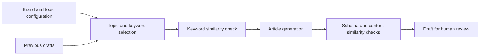

# SEO Content Engine

**Turn your brand's topic areas into structured SEO drafts ready for editorial review.**

A server-side TypeScript library and CLI powered by Gemini. It combines topic selection, keyword proposals, structured article generation and duplicate detection. Configure your brand once and generate titles, metadata, introductions, body sections and FAQs in a consistent format.

[Usage guide](docs/USAGE.md) · [New to GitHub?](docs/GITHUB.md) · [Sample output](examples/demo-output.md) · [Türkçe](README.tr.md)

> **No API key is needed to try the demo.** It runs offline with synthetic data. Live AI generation requires your own Gemini key, stored locally. This repository contains no real credentials or customer data.

## Who is this for?

- Developers and agencies building content workflows for multiple brands.
- Editorial teams organizing a content plan around topic areas and question angles.
- Teams adding draft generation to an existing CMS or Markdown workflow.

This release is a command-line tool and developer library. It does not include an admin dashboard. You review the output and decide how to publish it.

## Quick start

Install [Node.js 22.12 or newer](https://nodejs.org/en/download), then run:

```sh
git clone https://github.com/tkaancakir/seo-content-engine.git
cd seo-content-engine
npm ci
npm run demo
```

Without Git, choose **Code → Download ZIP**, extract the archive and run the last two commands in the directory containing `package.json`.

Installation downloads dependencies. The demo itself makes no model requests, writes no files and changes nothing on your website. It prints a sample Markdown draft containing:

```yaml
status: "draft"
reviewRequired: true
```

Every generated result requires human review. [See the complete sample output](examples/demo-output.md).

## What it does

| Feature | Behavior |
| --- | --- |
| Topic rotation | Selects the least-used topic area × question-angle combination from your history. |
| Target query | Proposes a long-tail search phrase for the chosen topic. |
| Duplicate checks | Checks keyword similarity before generation, then compares the title and excerpt with previous content. |
| Structured output | Generates a title, slug, metadata, keywords, tags, introduction, definition, body sections and FAQs. |
| Editorial checks | Validates the schema and flags blocked phrases and high-risk topics for review. |
| Draft-only results | Returns drafts only; fails if duplicate checks cannot complete or generation attempts are exhausted. |
| Integration helpers | Provides Markdown export, a generic Payload-style draft mapper and an authenticated HTTP handler. |



## Use your own brand

1. Copy `examples/config.json` to a local `config/local.json` file, creating the `config` directory first. Edit the brand, topics and editorial rules.
2. Copy `.env.example` to a local `.env` file. Put your own Gemini key in that local file only.
3. Run the generation command below. Choose a new output filename for each draft.
4. Review the text, claims, sources and brand voice before publishing.

```sh
node --env-file=.env --import tsx src/cli.ts --config config/local.json --history data/history.json --out data/draft-001.json
```

**[Follow the complete setup and usage guide →](docs/USAGE.md)**

Live generation sends configured brand context and relevant historical text to Gemini. Provider billing and quotas apply to your own account. The MIT license does not make API usage free. Model names are configurable; check availability in your account before live use.

Set `brand.locale` to your content language, such as `en` or `tr`. English is the default; documentation language does not limit the language of your drafts.

## Documentation

| Looking for | Read |
| --- | --- |
| Installation, first draft, configuration, output and troubleshooting | [Usage guide](docs/USAGE.md) |
| What Code, Issues, Fork, Pull request and Actions mean | [GitHub beginner guide](docs/GITHUB.md) |
| An editable example brand configuration | [Sample configuration](examples/config.json) |
| Environment variables with empty credential fields | [.env.example](.env.example) |
| Key handling and private vulnerability reports | [Security policy](SECURITY.md) |
| Reporting bugs and submitting changes | [Contributing](CONTRIBUTING.md) |
| Version scope and changes | [Changelog](CHANGELOG.md) |
| Turkish documentation | [Türkçe README](README.tr.md) · [Kullanım kılavuzu](docs/USAGE.tr.md) · [GitHub rehberi](docs/GITHUB.tr.md) |

## Development and verification

```sh
npm run check
```

This runs type checking, offline tests and the build. Tests cover duplicate detection, malformed provider responses, safe errors, authorization and local file locking. They do not call the live Gemini API. The GitHub Actions workflow runs the same checks plus secret scanning; inspect actual run results in the **Actions** tab.

After building, import the core from `./dist/src/index.js` and adapters from `./dist/src/adapters/index.js`. Implement the `ContentProvider` interface to use another provider. The package is not published on npm; `private: true` prevents accidental npm publication.

## Limitations

Keyword proposals are not search-volume data. Similarity checks use titles and excerpts; this is not a full-text plagiarism checker or web research service. People must verify factual accuracy, sources and editorial suitability. There is no automatic publication, installed scheduler or SEO ranking guarantee.

The Payload mapper requires a mapping to your actual collection schema. Distributed deployments must supply durable locking, idempotency and rate limits. The included HTTP helper only guards concurrency within one process.

## Help, contributions and license

Use [Issues](https://github.com/tkaancakir/seo-content-engine/issues/new/choose) for bugs and feature ideas. Never attach credentials, private `.env` files or customer content. Follow [SECURITY.md](SECURITY.md) for vulnerability reports.

Maintained by [@tkaancakir](https://github.com/tkaancakir). Contributions are welcome under [CONTRIBUTING.md](CONTRIBUTING.md); no response or release schedule is promised.

Licensed under the [MIT license](LICENSE).
