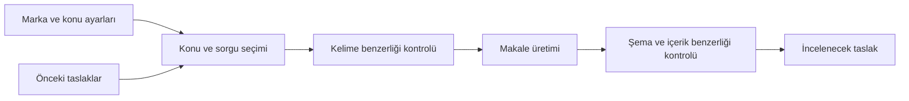

# SEO Content Engine

**Bir markanın konu alanlarından, editör incelemesine hazır SEO içerik taslakları üretin.**

Gemini kullanan, TypeScript ile yazılmış bir içerik motoru. Konu seçimini, yapılandırılmış makale üretimini ve benzerlik kontrolünü tek akışta birleştirir. Kendi marka bilgilerinizi yapılandırırsınız; motor başlık, meta açıklaması, giriş, gövde ve SSS alanlarını üretir.

[Türkçe kullanım kılavuzu](docs/USAGE.tr.md) · [GitHub'a yeni başlayanlar](docs/GITHUB.tr.md) · [English](README.md) · [Örnek çıktı](examples/demo-output.md)

> **Başlamak için API anahtarı gerekmez.** Çevrimdışı demo hazır örnek veriyle çalışır. Gerçek yapay zekâ üretimi için kendi Gemini anahtarınızı yerel ortamınızda tanımlarsınız. Bu depoda gerçek anahtar veya müşteri verisi bulunmaz.

## Kimler için?

- Birden fazla markanın içerik iş akışını ortak bir motorla yürütmek isteyen geliştiriciler ve ajanslar.
- İçerik planını konu alanlarına ve soru açılarına ayırmak isteyen editoryal ekipler.
- Kendi CMS'ine veya Markdown iş akışına taslak üretimi eklemek isteyenler.

Bu sürüm bir komut satırı aracı ve geliştirici kütüphanesidir. Hazır yönetim paneli sunmaz; çıktıyı web sitenize taşıma ve yayınlama adımı size aittir.

## İlk deneme

[Node.js 22.12 veya üzerini](https://nodejs.org/en/download) kurun. Git kullanıyorsanız terminalde:

```sh
git clone https://github.com/tkaancakir/seo-content-engine.git
cd seo-content-engine
npm ci
npm run demo
```

Git kullanmıyorsanız **Code → Download ZIP** ile indirin, ZIP'i açın ve terminali `package.json` dosyasının bulunduğu klasörde açın. Ardından son iki komutu çalıştırın.

Ekranda örnek bir Markdown taslağı görürsünüz. Demo ağ üzerinden model çağrısı yapmaz, dosya kaydetmez ve web sitenizde değişiklik yapmaz. Kurulumdaki `npm ci` bağımlılıkları internetten indirir.

```yaml
status: "draft"
reviewRequired: true
```

Bu alanlar her üretimin insan incelemesi gerektirdiğini gösterir. [Tam örnek çıktıya bakın](examples/demo-output.md).

## Neler yapar?

| Özellik | Davranış |
| --- | --- |
| Konu dağılımı | Geçmişte en az kullanılan konu alanı × soru açısını seçer. |
| Hedef sorgu | Seçilen konu için uzun kuyruklu bir arama ifadesi önerir. |
| Tekrar kontrolü | Önce anahtar kelimeyi, sonra başlık ve özeti önceki içeriklerle karşılaştırır. |
| Yapılandırılmış çıktı | Başlık, slug, meta alanları, anahtar kelimeler, etiketler, giriş, tanım, gövde ve SSS üretir. |
| Editoryal kontrol | Şemayı doğrular; yasaklı ifadeleri ve yüksek riskli konuları inceleme gerekçesi olarak işaretler. |
| Güvenli varsayılan | Yalnızca taslak döndürür. Tekrar kontrolü tamamlanamazsa veya denemeler tükenirse hata verir. |
| Entegrasyon | Markdown dışa aktarımı, genel Payload alan eşlemesi ve korumalı HTTP yardımcı fonksiyonu sunar. |



## Kendi markanızla kullanın

1. `examples/config.json` dosyasını yerel `config/local.json` dosyanıza kopyalayın; marka, konu ve editoryal alanlarını düzenleyin.
2. `.env.example` dosyasını yerel `.env` dosyasına kopyalayın. Kendi anahtarınızı yalnızca bu yerel dosyada tanımlayın.
3. Kılavuzdaki üretim komutunu çalıştırın. Taslak `data/` altında oluşur; her yeni taslak için farklı çıktı adı kullanın.
4. Metni, kaynakları, iddiaları ve marka dilini inceleyin. Yayınlama kararını kendiniz verin.

**[Adım adım kurulum ve kullanım →](docs/USAGE.tr.md)**

Gerçek üretimde marka ayarları ve geçmiş içeriklerin ilgili metinleri Gemini'ye gönderilir. API kullanımı kendi hesabınızın ücret ve kota koşullarına tabidir. Kodun MIT lisansı sağlayıcı kullanımını ücretsiz yapmaz.

## Belgeler

| Aradığınız bilgi | Belge |
| --- | --- |
| Kurulum, ilk üretim, ayarlar, çıktı, hata çözümleri | [Kullanım kılavuzu](docs/USAGE.tr.md) |
| Code, Issues, Fork, Pull request ve Actions ne demek? | [GitHub başlangıç rehberi](docs/GITHUB.tr.md) |
| Düzenleyebileceğiniz örnek marka ayarları | [Örnek yapılandırma](examples/config.json) |
| Gerçek anahtar içermeyen ortam değişkeni şablonu | [.env.example](.env.example) |
| Anahtar güvenliği ve özel hata bildirimi | [Güvenlik politikası](SECURITY.md) |
| Hata bildirme ve katkı gönderme | [Katkı rehberi](CONTRIBUTING.md) |
| Sürümde neler var? | [Değişiklikler](CHANGELOG.md) |

## Geliştirme ve doğrulama

```sh
npm run check
```

Bu komut TypeScript denetimini, çevrimdışı testleri ve derlemeyi çalıştırır. Testler tekrar kontrolü, bozuk model yanıtları, hata bilgisinin gizlenmesi, yetkilendirme ve yerel dosya kilitlemesini kapsar. Canlı Gemini çağrısı yapmaz. GitHub Actions için aynı kontrolleri ve gizli bilgi taramasını çalıştıran iş akışı depoda bulunur; çalıştırma sonuçları **Actions** sekmesinden incelenebilir.

## Sınırlar

Önerilen sorgu arama hacmi verisi değildir. Benzerlik kontrolü başlık ve özet üzerinden yapılır; tam metin intihal taraması veya web araştırması yapmaz. Üretilen metnin doğruluğu, kaynakları ve uygunluğu insan tarafından incelenmelidir. Otomatik yayınlama, zamanlayıcı kurulumu ve SEO sıralama garantisi sunulmaz.

Model adları ayarlanabilir. Örneklerdeki uyumluluk varsayılanlarının kendi Gemini hesabınızda kullanılabildiğini kontrol edin. Çok sunuculu kurulumlarda kalıcı kilit, tekrar çalıştırma kontrolü ve istek sınırları entegrasyonu yapan uygulamanın sorumluluğundadır.

## Yardım, katkı ve lisans

Hata veya geliştirme önerisi için [Issues](https://github.com/tkaancakir/seo-content-engine/issues/new/choose) bölümünü kullanın. Gerçek anahtar, `.env` dosyası veya müşteri içeriği paylaşmayın. Güvenlik bulgularında [SECURITY.md](SECURITY.md) yolunu izleyin.

Bakımcı: [@tkaancakir](https://github.com/tkaancakir). Katkılar [CONTRIBUTING.md](CONTRIBUTING.md) üzerinden kabul edilir. Belirli bir yanıt veya yayın takvimi taahhüt edilmez.

[MIT lisansı](LICENSE). Paket henüz npm üzerinden yayımlanmamıştır; `private: true` yanlışlıkla npm yayını yapılmasını önler. Kaynak kodu bu GitHub deposundan kullanabilirsiniz.
